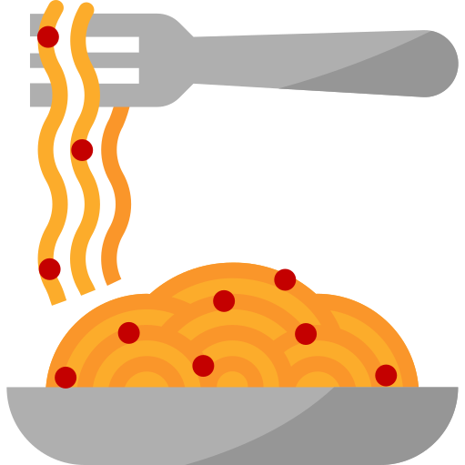

[](https://badge.fury.io/py/pasta-eln)
[](https://badge.fury.io/gh/PASTA-ELN%2Fpasta-eln)
[](https://github.com/PASTA-ELN/pasta-eln/actions/workflows/pypi.yml)
[](https://github.com/PASTA-ELN/pasta-eln/actions/workflows/installLinux.yml)
[](https://github.com/PASTA-ELN/pasta-eln/actions/workflows/docbuild.yml)
[](https://github.com/PASTA-ELN/pasta-eln/actions/workflows/pylint.yml)
[](https://github.com/PASTA-ELN/pasta-eln/actions/workflows/mypy.yml)

# PASTA-ELN



PASTA-ELN is a local electronic lab notebook for experimental scientists. It organizes raw data, metadata, projects, and associated files in a desktop application built with Python and PySide6.

The full user and developer documentation is available at [PASTA-ELN documentation](https://pasta-eln.github.io/pasta-eln/).

## Quick start

PASTA-ELN supports Python 3.10 and later.

```bash
pip install -r requirements-linux.txt  # or requirements-windows.txt
pip install -e .
python -m pasta_eln.gui
```

For development tools, install `requirements-devel.txt`. Run the following commands from the repository root:

```bash
QT_QPA_PLATFORM=offscreen python -m pytest tests/
python -m mypy pasta_eln
python -m pylint pasta_eln
```

Build the documentation with `make -C docs html`.

For maintainer release work, `releaseVersion.py` provides a broader verification run; invoke it manually only.

## Open issues

Open issues are the union of:

- [GitHub Issues](https://github.com/PASTA-ELN/pasta-eln/issues), which tracks actionable bugs, enhancements, and discussion; and
- this README section, which records repository-wide maintenance items that need visibility before or alongside an issue.

### Repository maintenance items
- Blocking polling in asynchronous UI paths
Some asynchronous backend requests are converted into synchronous calls by connecting a signal and repeatedly sleeping until a result appears. These loops have no timeout, cancellation, or failure path, and their temporary signal handlers are not disconnected. A missed signal or backend failure can therefore block indefinitely; repeated calls can also accumulate callbacks and return unrelated responses.
Examples:
- [`getHierarchy()` (line 266)](/home/steffen/FZJ/PASTA/pasta-eln/pasta_eln/addons.py:266)
- [`getDoc()` (line 297)](/home/steffen/FZJ/PASTA/pasta-eln/pasta_eln/addons.py:297)
- History loading in [`Form.execute()` (line 781)](/home/steffen/FZJ/PASTA/pasta-eln/pasta_eln/ui/form/form.py:781)
- Broad and inconsistent exception handling: create and document a consistent exception handling
The package contains many except Exception blocks, including paths that merely print, log, return an empty value, or silently pass. This erases distinctions between expected operational failures and programming defects. Callers cannot consistently determine whether an operation succeeded, and corrupted intermediate state may continue through the application after the original error context has been lost.
Examples:
- Add-on failures become {} in [`callAddOn()` (line 201)](/home/steffen/FZJ/PASTA/pasta-eln/pasta_eln/addons.py:201)
- Auto-comment failures are suppressed in [`Form.execute()` (line 644)](/home/steffen/FZJ/PASTA/pasta-eln/pasta_eln/ui/form/form.py:644)
- Download errors are only printed in [`callDataExtractor()` (line 227)](/home/steffen/FZJ/PASTA/pasta-eln/pasta_eln/addons.py:227)
- Tutorial
  - Create an interactive tutorial runner as a separate program launched from the main program. It should use a read-only SQLite connection, define a clear busy-timeout/WAL strategy for concurrent access, and maintain its own JSON file to track tutorial progress.
  - Rewrite the tutorial content with more steps, details, screenshots, contextual help, and clear expected results.
